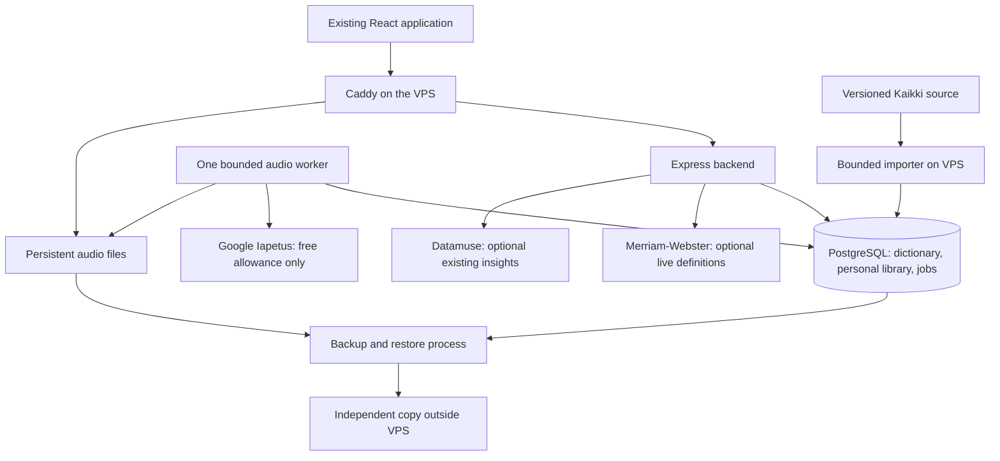

# Word Atlas architecture and implementation plan

Date: 29 October 2026. Status: agreed product direction; implementation pending.

This is the current implementation plan. It supersedes the mini-PC and Piper recommendations in the earlier research. The existing redesign stays intact. This document does not claim that the expanded dictionary, production database integration, or audio pipeline has already been deployed. Execution tasks are in [todo.md](todo.md); the decision record is in [ADR 0001](../docs/decisions/0001-dictionary-and-pronunciation-architecture.md).

## 1. Outcome and settled decisions

The first priority is substantially better coverage: ordinary and uncommon English words, inflections, alternate spellings, technical vocabulary, idioms, phrasal verbs, and other multiword expressions. Searches should resolve against a persistent local dictionary rather than depend on one external API recognizing the spelling.

| Decision | Architecture |
|---|---|
| Design | Preserve the current layout, typography, interactions, themes, and responsive design. Add only the states needed for sources, sync, and audio readiness. |
| Hosting | Existing VPS for every self-hosted component, including dictionary imports. No mini-PC dependency. |
| Permanent dictionary | English Wiktionary data extracted by Kaikki/Wiktextract, stored in PostgreSQL with provenance. |
| Editorial definitions | Existing Merriam-Webster Learner’s and Collegiate integrations, improved and treated as optional live sources. |
| Definition style | Short, direct, source-authored meanings; separate senses, grammar labels, and examples, inspired by the former Oxford dictionary presentation. |
| Database | Dedicated Word Atlas database and restricted role in the existing VPS PostgreSQL service. |
| Voice | Google Chirp 3 HD **Iapetus**, `en-US-Chirp3-HD-Iapetus`, normal speaking rate. |
| Audio | Generate a pronunciation once when needed, store a compressed file on the VPS, reuse it across searches and users. |
| Personal data | PostgreSQL owns saved words and search history; migrate existing browser data without deleting it prematurely. |
| Cost | No additional paid service, paid synthesis, or welcome-credit consumption without explicit authorization. Use verified free allowances and stop new generation when allowance is uncertain or exhausted. Existing VPS rental remains an existing expense. |

Broad coverage is achievable; “every English word and idiom” is not a defensible guarantee. Coverage reports must distinguish headwords, senses, forms, and expressions rather than add incompatible source counts.

## 2. System layout

Keep React/Vite, Node/Express, Caddy, and Docker. Add PostgreSQL access, migrations, a small importer, and one audio worker that can use the same backend image. PostgreSQL holds the small durable job queue; no Redis, Elasticsearch, vector database, Kubernetes, or local speech model is needed initially. Build only the indexes that actual lookup queries need.

Google is the only speech-generation dependency. After an audio file is stored, ordinary playback works without Google or the home network.

## 3. Expand the dictionary first

### Permanent open-data foundation

Import the supported raw Kaikki English-edition export, streaming decompression and filtering records to `lang_code = "en"`. The English edition contains other languages too. Do not use the deprecated postprocessed English export as the long-term import contract. Save the exact source release, download URL, checksum, extractor version, and importer version.

Kaikki currently reports approximately **1.4 million distinct English forms**, including inflections and names; this is an indication of scope, not the number of standalone dictionary headwords. Measure usable entries and expression coverage after our own import. [Kaikki English index](https://kaikki.org/dictionary/English/), [supported raw exports](https://kaikki.org/dictionary/rawdata.html).

Preserve definitions, examples where licensed, part of speech, usage labels, spelling variants, inflections, pronunciation information, etymology, and semantic relationships when supplied. Handle form-only records by linking to the relevant lemma and showing what grammatical form the user searched. Do not manufacture a missing definition or assume a stemmer’s guess is a verified match.

### Idioms and phrases are searchable entries

An expression receives a full entry with its own senses, examples, forms, and pronunciations. Extract standalone expressions and embedded phrase/derived-form records where the source provides them. Preserve labels distinguishing idioms, phrasal verbs, proverbs, collocations, and literal phrases; these are not interchangeable categories.

Search exact phrases and source-supplied variants. Display expressions related to a headword on its existing phrase section. Apostrophe, whitespace, and hyphen normalization should improve matching while retaining the original spelling. Fuzzy matching suggests candidates; it never silently asserts that a different expression is the requested one. Corpus updates and a persistent unresolved-search list make future expansion possible.

### Merriam-Webster and existing enrichments

Fix the current bottleneck in `getWordDetails.js`: a Learner’s miss must not discard a valid Collegiate definition. Expand both normalizers to preserve complete definition blocks, relevant subsenses, examples, phrases, forms, and pronunciation variants. Match entries before attaching origins or quotations; do not attach unrelated homographs merely because the spelling matches.

Merriam-Webster remains a live editorial source for user-requested entries, with separate per-reference quotas and deadlines. Do not bulk harvest it, use it as the import corpus, or assume indefinite storage rights for its definitions, examples, or recordings. Its published free terms limit use to two references, 1,000 queries/day/reference, and non-commercial use. Default to no durable proprietary-content cache until the permitted policy is established. Store source identifiers and the user’s own records independently. [Merriam-Webster terms](https://dictionaryapi.com/info/terms-of-service).

Retain Datamuse-backed maps, rhymes, and other existing insights as optional enrichment. Route quota-sensitive requests through the backend. Failure of any optional provider must not prevent the dictionary result from loading. Additional providers such as Open English Wordnet can be evaluated later; they are not required to ship the core expansion.

### Editorial rules

Use the clearest concise source gloss for the initial display; show distinct senses and parts of speech separately. Keep examples separate from definitions, preserve regional/technical/archaic labels, and let users expand additional detail without truncating the meaning. Show the actual source. Where Learner’s or Collegiate content is available, preserve its editorial wording and source identity.

Do not generate definitions with an LLM, scrape Oxford, or label another dictionary’s wording “Oxford.” Open-data quality varies, particularly for rare vocabulary; presentation can be consistent even when editorial quality is uneven. Preserve Wiktionary attribution, article links, license/version, and modification provenance. Check media and quoted-example rights separately. [Wiktionary copyright](https://en.wiktionary.org/wiki/Wiktionary:Copyrights).

## 4. What “save every word” means

The imported dictionary is already persistent before any user searches. A submitted search creates or updates a persistent search record, including unresolved terms. A successfully resolved entry is referenced by a stable ID. Repeating a word updates its history rather than duplicating the dictionary entry. Typing autocomplete characters does not create history rows, provider calls, or audio jobs.

| Data | Storage and identity |
|---|---|
| Dictionary releases and sources | `dictionary_releases`, `sources`: release status, checksums, source URLs, licenses, attribution. |
| Stable lexical entries | `entries`: stable ID, language, display headword, part of speech, homograph identity, entry kind. |
| Source-specific content | `source_entries`, `senses`, `examples`: source/release identity and ordered source-authored content. Import only content we may retain. |
| Forms and relationships | `forms`, `entry_relations`: exact aliases, grammatical forms, lemma references, phrase relationships. |
| Pronunciation identity | `pronunciations`, `sense_pronunciations`: language/accent, source IPA, validated synthesis representation, and sense/entry associations. |
| Generated recordings | `audio_assets`: unique configuration key, file path, checksum, format, duration, readiness and failure status. Binary audio lives outside PostgreSQL. |
| Personal library | `users`, `saved_entries`, `search_history`: user ownership, submitted/display term, resolved entry when available, first/last visit, visit count, save time, and user notes if supported. |
| Work and usage | `audio_jobs`, `provider_usage`: unique jobs, leases, attempts, reserved/consumed provider allowance, errors and timestamps. |

These are logical table boundaries, not a requirement for a large framework or an ORM. Prefer the `pg` driver, parameterized SQL, versioned migrations, and focused repository modules unless implementation reveals a concrete need for more abstraction.

Keep source-specific entries distinct; do not automatically merge unrelated senses across dictionaries. Stable IDs must survive corpus refreshes: maintain source mappings and explicitly handle ambiguous remapping. A removed or changed source record must not cascade-delete a saved word, its notes, history, or audio. Maintain a tombstone or unresolved reference until it can be reconciled.

An unknown search is stored as an unresolved query, not invented as a dictionary entry. For a proprietary-only result, persist the term, source reference, and user state; do not silently store restricted text in a JSON snapshot. This distinction also applies when migrating old browser records.

## 5. Lookup and API behavior

1. Validate query length and characters; retain the display spelling and derive a Unicode-normalized search key. Keep exact case-sensitive distinctions such as `US` and `us`, then offer case-folded candidates where appropriate.
2. Query indexed exact headword/phrase and form mappings. Resolve form links with cycle and ambiguity handling. Use prefix indexes for autocomplete and bounded `pg_trgm` suggestions on misses.
3. Return the local entry and its saved pronunciation status immediately. Record the submitted search through an authenticated, idempotent personal-history write.
4. Request optional editorial data only for an opened entry. Prefer Learner’s for concise editorial meanings, with Collegiate as a real fallback. A short bounded initial deadline may select already-available editorial content; late results appear as an additional source without replacing text the user is reading. Never make local availability depend on the provider.
5. Prepare audio for the selected pronunciation only. An unresolved spelling, hover, speculative suggestion, or full corpus import must not trigger synthesis.

Keep `GET /api/words?term=...` working while the frontend migrates; extend the existing `{ word, quotes }` response with stable IDs, source information, match type, and pronunciation records. Proposed additional routes:

| Route | Responsibility |
|---|---|
| `GET /api/suggestions?term=...` | Local bounded prefix/form/phrase suggestions. |
| `GET /api/entries/:id/enrichment` | Optional provider content with explicit availability and source. |
| `GET /api/me/library`, `PUT/DELETE /api/me/library/:id` | Paginated saves and idempotent save/remove operations. |
| `GET/POST /api/me/history`, `DELETE /api/me/history` | Personal recent-search records and explicit history deletion. |
| `POST /api/me/import` | Validated, idempotent import of browser saves/history. |
| `POST /api/pronunciations/:id/audio` | Return existing file or enqueue one permitted synthesis job. |
| `GET /api/pronunciations/:id/audio` | Read readiness: ready, pending, unavailable, allowance exhausted, or failed. |
| `GET /audio/:assetKey` | Serve an immutable validated audio file through Caddy. |

Audio preparation must use server-owned pronunciation IDs; do not expose an unrestricted text-to-speech endpoint or accept arbitrary filenames/voice names. Personal routes are private and must never inherit the existing public dictionary cache headers. Responses distinguish not-found from provider failure; an external outage is not evidence that a word does not exist.

## 6. Iapetus pronunciation and instant replay

The approved default is `en-US-Chirp3-HD-Iapetus`, speaking rate `1.0`. Use a browser-supported compressed format, initially MP3, and compare the chosen encoding to the audition before rollout. The audition files are WAV; production compression is an implementation choice, not a voice change.

For example, `lead` as a verb uses `/liːd/`, while the metal uses `/lɛd/`. They must have different pronunciation IDs and cache keys. Preserve all source variants and map senses to the correct pronunciation. Validate dictionary phonemes against Google’s supported representation; if an ambiguous word cannot be resolved safely, show available choices or withhold that recording instead of guessing. [Google pronunciation controls](https://docs.cloud.google.com/text-to-speech/docs/chirp3-hd#custom_pronunciations).

The cache key includes canonical spoken text, language, pronunciation/phoneme override, provider, voice, application-controlled synthesis version, format, and relevant settings. Meanings that sound the same can share an asset; the two pronunciations of `lead` cannot. Corpus release changes alone must not invalidate all audio. Store existing clips even if Google later changes the underlying model.

One worker claims a unique PostgreSQL job with a lease. It reserves allowance atomically, sends one request, validates the result, writes a temporary file, atomically renames it, then marks the asset ready. Concurrent searches reuse the same job. Recover completed files after a crash rather than regenerate them. A timeout after transmission can mean Google already synthesized the clip: retain the usage reservation and mark the outcome uncertain; do not blindly retry. Exactly-once external billing cannot be guaranteed across network failure, but deduplication and reconciliation prevent ordinary duplicate calls.

Prepare and preload the selected clip when the entry opens. Reuse the browser audio object on clicks. A saved file usually eliminates synthesis delay; a downloaded clip eliminates the network wait too. New, uncached audio still depends on Google latency and must show a brief loading state.

Targets to verify: cached/preloaded click-to-sound p95 under 200 ms; already-cached server audio on the user’s normal connection p95 under 500 ms; aim for 1–2 seconds for first-time generation, without promising it before measurement. Test actual playback and leading silence, not just HTTP response time. Do not silently switch away from Iapetus; any optional device-voice fallback must be explicit and distinguishable.

## 7. Enforce the no-spending requirement

Google currently lists one million free Chirp 3 HD input characters per month, with automatic billing beyond the allowance. Spaces and applicable markup count. The allowance is not one million words and must be considered across the billing account. [Google pricing](https://cloud.google.com/text-to-speech/pricing).

Proposed initial application limit: **100,000 conservatively counted characters/month**, well below the published allowance, adjusted downward for other account usage and prior auditions. This is a technical safety default, not authorization for paid use. Reconcile the provider’s billing period and existing account consumption before enabling production synthesis. Allocate a known portion of the free allowance to Word Atlas; other producers using the same allowance must be accounted for. If remaining allowance cannot be established, leave new generation disabled.

Persist usage across restarts; reserve characters under a transaction lock before dispatch, including simultaneous requests. Count the full billable input conservatively and retain reservations for uncertain outcomes. Restrict the allowed voice/model, request length, authenticated users, daily request rate, worker concurrency, and retries. Reject any request that would exceed the app allocation. Cached playback remains available when synthesis stops. Alerts at 50/80/95% of the allocation are useful, but a Google budget alert is not a hard spending cap.

The app cannot guarantee zero account-wide charges if unrelated applications consume the same allowance outside its ledger. Resolve that uncertainty before new synthesis instead of consuming welcome credit. Existing paid-account status is not permission to spend. Merriam-Webster gets separate daily counters and stops at its free limits, falling back to the open corpus.

## 8. Personal persistence and access

Start with one owner account and no public sign-up. Inspect the existing Nexo identity service before choosing the integration; its presence is not evidence that it is ready for production use. Reuse it only if its session and validation contract meets the requirements. Otherwise use a small established authentication solution; do not build custom password cryptography.

Use secure HttpOnly same-origin session cookies, appropriate SameSite/CSRF protection, and server-side ownership checks. A client-supplied user ID must never select another user’s library. Keep provider credentials and database access on the backend; PostgreSQL stays on the private container network. Replace developer ADC credentials with an appropriately restricted production identity before deployment; never copy the personal development credential into the frontend or image.

After login, detect `wa:saved` and `wa:history`, validate and import them with stable idempotency keys, and preserve timestamps. Resolve entries where possible while retaining unresolved personal items. Keep original browser records until the database confirms successful import and the result is verified. Retry must not duplicate saves or visit counts. Remove the current 50-item server-history limitation; paginate the database-backed history. Keep export and explicit clear-history controls. Theme preferences and disposable caches may remain local.

## 9. VPS capacity, imports, and backups

The 29 October inspection found 2 vCPUs, 3.7 GiB RAM with 2.2 GiB available, roughly 2% recent average CPU use, and only 11 GiB free disk. PostgreSQL already has a 512 MiB container limit and a 30-connection maximum. Use a small backend pool, initially around five connections, and account for the worker/importer and other databases before changing limits. A combined backend/database working budget of roughly 0.5–1 GiB is a starting point to measure, not a proven full-corpus footprint.

Disk preparation is a prerequisite. Review unused Docker build artifacts and obsolete images while retaining current and rollback images; never prune database volumes. Aim initially for 20–30 GiB free, then require measured room for the corpus, indexes, WAL, staging/rollback release, audio, and backups. Reported reclaimable image/cache sizes overlap and do not guarantee that much free space. No cleanup has yet been performed.

Run one importer on the VPS at low priority with bounded memory and transaction batches. Do a representative sample import first, measure storage and index overhead, and extrapolate before the full job. Stream the multilingual source rather than writing an uncompressed copy. Validate counts, parsing errors, examples, forms, and phrase links before publication. Publish a release with an atomic active-version switch and a verified rollback path. Do not start a full staged refresh if retaining both releases and WAL would exhaust disk. Keep stable user identities outside release-specific content.

Start with manually initiated corpus refreshes; monthly refresh is a later proposed cadence, not an automation already scheduled. Keep a release manifest and an audit of rejected records. Stop imports/generation when low disk threatens database availability; never automatically delete personal data or all cached speech to make room.

Make nightly PostgreSQL backups, retain a bounded rotation, and separately preserve generated audio and its metadata. Target at most 24 hours of personal-data loss and a two-hour restore for the current small deployment, then prove those targets in a restore exercise. Maintain an encrypted independent copy outside the VPS. A copy to the user’s Mac can be free but only runs when it is reachable; backup age must be visible, and we cannot claim a 24-hour offsite recovery point without a reliable destination. Selecting that destination remains a deployment gate, with no paid storage assumed.

Initial capacity target: validate 20–50 simultaneously active readers at about 2–5 lookups/second, under the observed other VPS workloads. This is not a measured maximum. A single-user deployment does not justify a hardware upgrade now. [VPS inspection](../docs/research/vps-only-feasibility-2026-10-29.md).

## 10. Delivery order and acceptance

1. Capture a representative coverage baseline and the current API/UI contract; check disk/import feasibility early.
2. Establish PostgreSQL and import a small open-data sample; deliver one complete persistent lookup path.
3. Complete Learner’s/Collegiate adapters, phrase/form resolution, and local suggestions.
4. Import and validate the full English corpus; publish it without changing the design.
5. Add owner authentication and persistent saves/history; migrate browser data safely.
6. Add pronunciation identities, allowance accounting, Iapetus generation, durable cache, and browser preloading.
7. Prove backup restoration, fault behavior, and performance; deploy in reversible stages.

The detailed task checklist defines dependencies and verifiable results. Tests should cover meaningful risks: source parsing, ambiguous form/sense mappings, duplicate migration, authorization, quota races, duplicate synthesis, and crash recovery. The repository currently has lint/build commands but no backend test script; add Node’s test runner for focused backend fixtures rather than pretend an existing suite exists.

Before completion, demonstrate:

- Previously missing words resolve through Collegiate or the open corpus. Every successfully imported exact English headword/phrase is reachable; form aliases resolve or return a clear ambiguity.
- A fixed corpus evaluation set covers common words, rare/technical words, inflections, punctuation variants, heteronyms, and at least 50 idioms/phrasal verbs. Report coverage by category and compare the old/new resolver using the same licensed local fixtures. Do not automate comparative benchmarks against Merriam-Webster’s service.
- Source senses, examples, and labels survive import and display. Counts and sample audits reveal no systematic truncation or silent record loss; remaining gaps are listed, not hidden by a headline count.
- Saves/history survive browser changes, backend restart, and corpus refresh. Failed or repeated migration preserves the original data and does not duplicate records.
- `lead` and other reviewed heteronyms play the intended Iapetus pronunciation. Replays and simultaneous requests for an existing asset make zero synthesis calls.
- Unknown allowance, exhausted limits, external outages, worker restart, and low disk produce useful states without paid fallback or lost personal data.
- Dictionary response p95 target is under 500 ms for the local path at the agreed test load, and the separate playback targets are measured on desktop and phone. No unverified capacity or instant-first-generation promise is made.
- The existing visual design and core navigation remain intact. Backup restoration and rollback have been exercised before replacing the live data path.

## 11. Outstanding implementation checks

These do not reopen the settled product direction: measured full-corpus size; usable Nexo identity integration; verified production Google identity and free-allowance accounting; proprietary caching policy; a reliable off-VPS backup destination; and measured cold-generation latency. Resolve them within their tasks. Do not buy infrastructure, expand paid usage, or substitute another voice to work around an unresolved check.

Supporting research: [dictionary sources](../docs/research/dictionary-sources-2026-10-26.md), [Google setup](../docs/research/google-cloud-setup-2026-10-29.md), [voice audition](../docs/research/audio-comparison/google-free-tier-2026-10-29/README.md).
